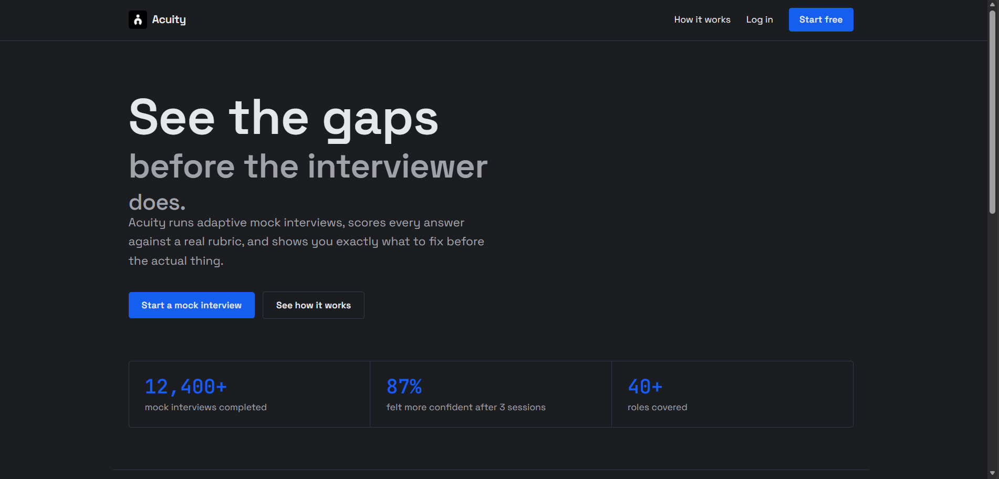
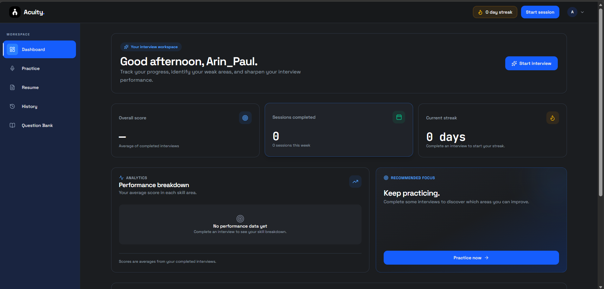
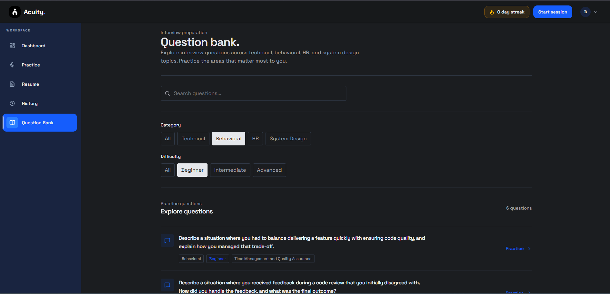
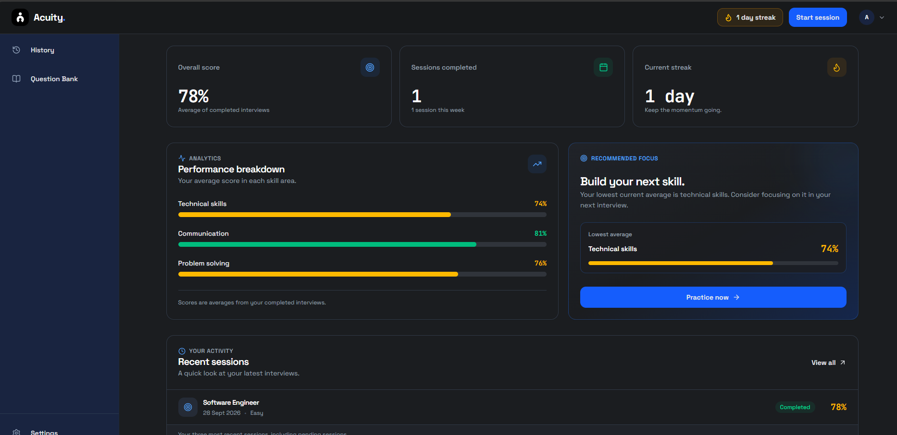

# Acuity — AI Interview Preparation Platform

**Acuity** is a full-stack AI-powered interview preparation platform designed to help candidates practice Technical, Behavioral, HR, and System Design interviews.

It brings together interview practice, a searchable question bank, performance tracking, interview history, and resume management in one platform.

**Live Demo:** [Acuity AI Interview Platform](https://acuity-frontend-969c.onrender.com)

---

## Screenshots

| Landing Page | Dashboard |
|:---:|:---:|
|  |  |

| Question Bank | Interview Results |
|:---:|:---:|
|  |  |

---

## Features

- 🔐 **JWT Authentication** — Secure user authentication.
- 🤖 **AI-Powered Question Generation** — Generate interview questions using the Groq API.
- 📚 **Searchable Question Bank** — Search and filter questions by category, difficulty, and topic.
- 🎯 **Multiple Interview Categories** — Technical, Behavioral, HR, and System Design.
- 📊 **Performance Dashboard** — Track interview activity and performance metrics.
- 📝 **Interview History & Results** — Review completed interview sessions and recorded results.
- 📄 **Resume Management** — Manage resumes within the platform.
- 🛡️ **Duplicate Detection** — Detect exact and near-duplicate questions.
- 🔄 **Pagination** — Browse questions through paginated results.
- 📱 **Responsive UI** — Designed for different screen sizes.

---

## Tech Stack

### Frontend
- React
- Vite
- Tailwind CSS
- React Router
- Axios
- TanStack React Query
- Socket.IO Client
- Lucide React

### Backend
- Python 3.11
- Django
- Django REST Framework
- Simple JWT
- Gunicorn
- uv

### Database & AI
- PostgreSQL
- Neon PostgreSQL
- Groq API
- `openai/gpt-oss-20b`

### Deployment
- Render — Frontend and Backend
- Neon — PostgreSQL Database

---

## Architecture

```text
                  React + Vite
                       |
                       | REST API
                       v
              Django REST Framework
                       |
             +---------+---------+
             |         |         |
             v         v         v
         PostgreSQL  Groq API  JWT Auth
           (Neon)    (AI Model)
```

---

## AI Question Generation Pipeline

Acuity uses a Django management command to generate and validate interview questions through the Groq API before storing them in PostgreSQL.

```text
           Groq API
               |
               v
      Generate Questions
               |
               v
   Validate Category, Difficulty
            and Topic
               |
               v
      Duplicate Detection
               |
               v
          PostgreSQL
               |
               v
        Django REST API
               |
               v
       React Question Bank
```

The question-generation pipeline includes:

- Category, difficulty, and topic validation.
- Text normalization.
- Exact duplicate detection.
- Similarity-based near-duplicate detection.
- PostgreSQL persistence for validated questions.

### Generate Questions

Run the following command from the backend directory:

```bash
uv run python manage.py generate_questions --count 10
```

---

## Project Structure

```text
Acuity/
├── backend/
│   ├── config/
│   ├── sessions/
│   │   └── management/
│   │       └── commands/
│   │           └── generate_questions.py
│   └── manage.py
│
├── src/
│   ├── api/
│   ├── components/
│   ├── features/
│   │   ├── auth/
│   │   ├── dashboard/
│   │   ├── questions/
│   │   ├── resumes/
│   │   └── sessions/
│   └── hooks/
│
├── docs/
│   └── screenshots/
│       ├── landing.png
│       ├── dashboard.png
│       ├── question-bank.png
│       └── results.png
│
├── package.json
└── README.md
```

---

## Local Setup

### Prerequisites

- Python 3.11
- uv
- Node.js and npm
- PostgreSQL database
- Groq API key

### 1. Clone the Repository

```bash
git clone https://github.com/Ujjvl-hub/Acuity.git
cd Acuity
```

### 2. Configure the Backend

Create a `.env` file in the backend directory:

```env
SECRET_KEY=your_secret_key
DATABASE_URL=your_postgresql_url
GROQ_API_KEY=your_groq_api_key
```

Install dependencies and run database migrations:

```bash
cd backend
uv sync
uv run python manage.py migrate
uv run python manage.py runserver
```

### 3. Configure the Frontend

Open a separate terminal in the frontend root directory and create a `.env` file:

```env
VITE_API_BASE_URL=http://127.0.0.1:8000
```

Install dependencies and start the development server:

```bash
npm install
npm run dev
```

**Security note:** Never commit API keys, database credentials, or secret keys to GitHub. Configure production environment variables through your hosting provider.

---

## Application Flow

```text
       Login / Register
              |
              v
          Dashboard
              |
              v
         Question Bank
              |
              v
       Interview Practice
              |
              v
       Interview Results
              |
              v
       Interview History
```

---

## Deployment

Acuity uses the following deployment architecture:

| Component | Technology |
|---|---|
| Frontend | Render |
| Backend API | Render |
| Database | Neon PostgreSQL |
| AI Question Generation | Groq API |

**Live Application:** https://acuity-frontend-969c.onrender.com

---

## Known Issue

**Initial registration connection delay on Render**

When a new user attempts to create an account for the first time, the application may display an "Unable to connect" message. Retrying the registration request generally succeeds.

**Possible cause:** The issue may be related to cold-start latency when a free-tier Render backend instance starts after a period of inactivity. However, the root cause has not been confirmed.

**Current workaround:** Retry the registration request if the initial attempt fails.

**Potential improvement:** Investigate backend startup latency, API response timing, and frontend timeout handling to identify the underlying cause and improve the registration experience.

---

## Author

**Ujjwal Kumar**  
B.Tech — Computer Science and Engineering

- **GitHub:** [@Ujjvl-hub](https://github.com/Ujjvl-hub)
- **Live Project:** [Acuity AI Interview Platform](https://acuity-frontend-969c.onrender.com)

---

## License

No license has currently been specified for this project.
